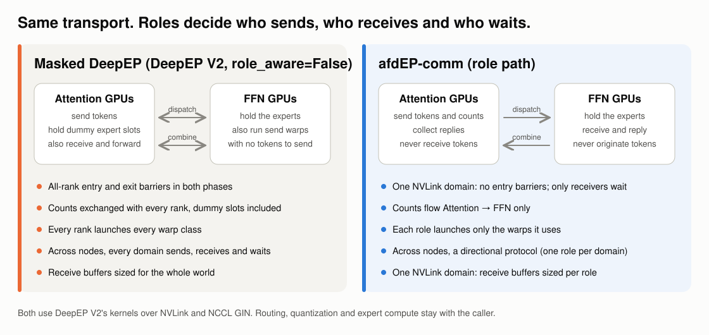
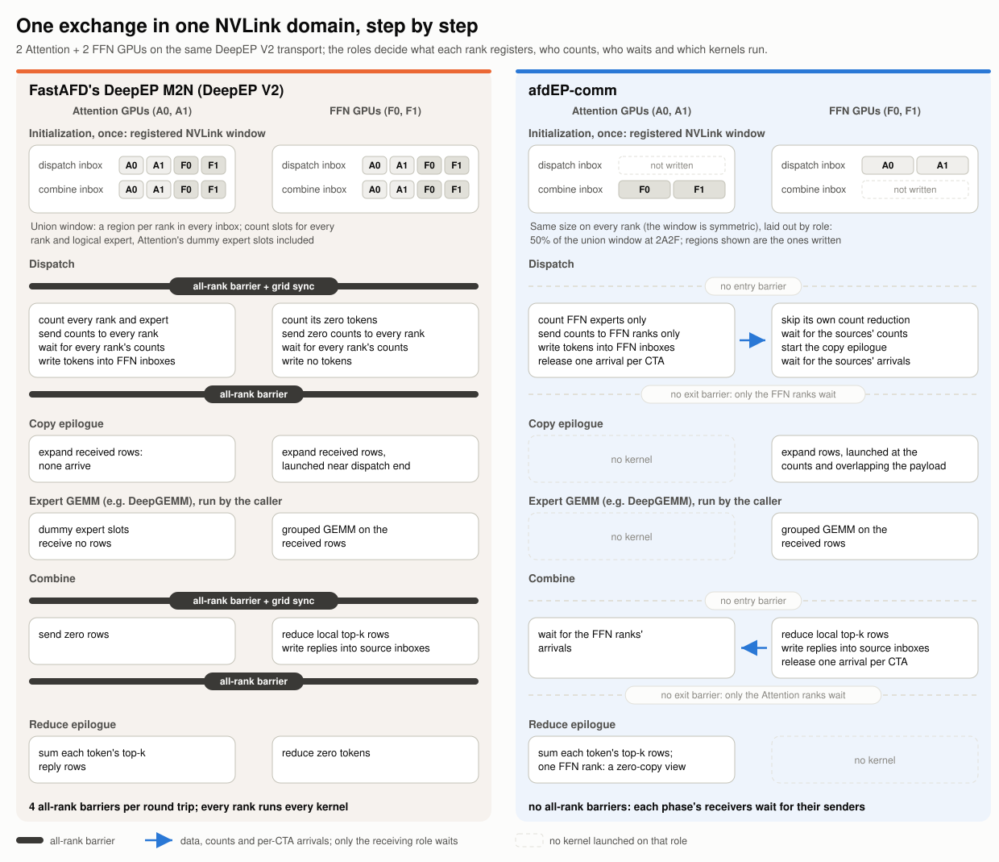
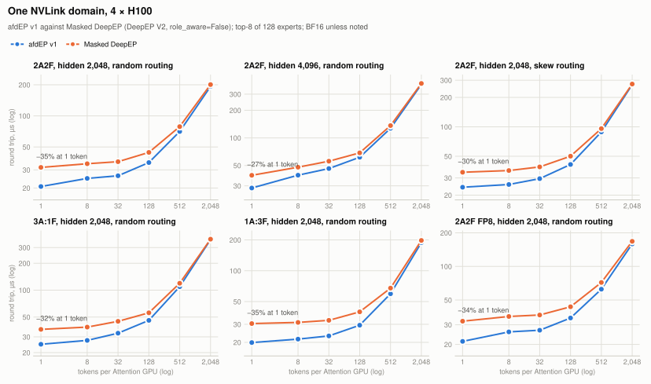
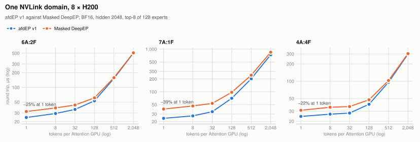
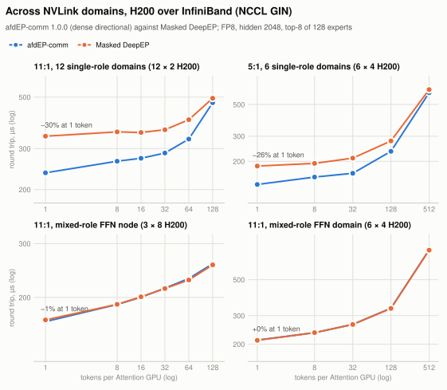
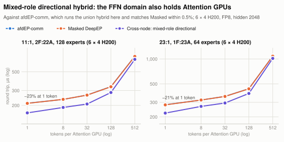

<div align="center">


<p><b>Expert-parallel communication for Attention–FFN Disaggregation (AFD).</b></p>

</div>

afdEP-comm connects N Attention GPUs, which route tokens, with M FFN GPUs, which hold the
experts: it dispatches routed tokens to the experts and combines their outputs back at
the source. It vendors DeepEP V2's kernels and specializes them for the two roles.
Routing, quantization, expert compute and serving scheduling stay with the caller.

<picture>
  <source media="(prefers-color-scheme: dark)" srcset="docs/assets/communication-dark.svg">
  
</picture>

## What afdEP-comm changes

Every result here is measured against **FastAFD's DeepEP M2N**, the way
[FastAFD](https://github.com/hao-ai-lab/FastAFD) runs AFD over DeepEP V2
([`DeepEPM2NAdapter`](https://github.com/hao-ai-lab/FastAFD/blob/3c7161949310b6d59d6b4cf9bf997a4935c8113b/python/minisgl/moe/deepep_m2n_adapter.py)). DeepEP sees one symmetric
expert-parallel group: Attention ranks hold dummy expert slots that no token routes to,
and every rank sends, receives and waits in both phases. The
[AFD plugin](https://github.com/ms-llmd/afd-plugin) served the same code in vLLM through
its `deepep_m2n` connector.

afdEP-comm runs the same DeepEP V2 kernels and removes only what the two roles make
unnecessary: Attention GPUs only send in dispatch and only receive in combine, and FFN
GPUs the reverse. A change that would speed up FastAFD's DeepEP M2N as well is out of
scope. The benchmarks run the baseline over the same vendored kernels and harness
([benchmarks/fastafd.py](benchmarks/fastafd.py)). Every change keeps an environment
control that reverts it for measurement, except the sparse directional hybrid, which is
part of the cross-node protocol from 1.1.0.

One exchange in one NVLink domain, with every barrier, the kernels each role runs and
the inbox regions each rank registers and receives into:

<picture>
  <source media="(prefers-color-scheme: dark)" srcset="docs/assets/pipeline-dark.svg">
  
</picture>

In one NVLink domain:
- no entry barriers [§1](docs/design.md#1-entry-barriers); counts flow Attention → FFN only [§2](docs/design.md#2-directional-count-exchange);
  only receivers wait at exit, per sending CTA [§3](docs/design.md#3-directed-exit);
- receive buffers sized per role, 50% of the union registration at 2A2F and about 75%
  at 3:1 and 1:3 [§4](docs/design.md#4-role-sized-registered-buffers);
- each role launches only the warps it uses, and the FFN starts its copy epilogue at the
  counts [§14](docs/design.md#14-role-suites-launch-only-what-each-role-uses), [§15](docs/design.md#15-ffn-receive-copy-epilogue-trigger-at-the-counts-one-nvlink-domain);
- with one FFN rank, a single-FFN reduction and a zero-copy collect view
  [§10](docs/design.md#10-single-ffn-reduction), [§13](docs/design.md#13-single-ffn-collect-view).

Across NVLink domains joined by NCCL GPU-Initiated Networking (GIN):
- a directional protocol when every domain holds one role: no cross-domain barriers,
  and counts, payloads, finish tails and combine signals each flow one way
  [§7](docs/design.md#7-directional-hybrid-protocol), with route checks in the kernel
  [§8](docs/design.md#8-route-checks-inside-the-directional-hybrid-dispatch) and staging kept out of remotely written inboxes
  [§11](docs/design.md#11-staging-outside-remotely-written-inboxes-fix);
- in that protocol, signals only on the channels that carry tokens: sources start on
  staggered channels, and finish tails and combine signals skip empty channels, up to
  68% off the small-batch round trip ([what it adds](docs/sparse-hybrid.md),
  [§17](docs/design.md#17-sparse-directional-hybrid-default-across-nvlink-domains));
- domains that hold both roles (FFN GPUs sharing a node with Attention GPUs) run
  DeepEP's union hybrid and match FastAFD's DeepEP M2N within 1.4%; the
  [cross-node additions](#cross-node-additions-opt-in) add a directional path for them.

Opt-in and off by default: the [cross-node additions](#cross-node-additions-opt-in) ([§18](docs/design.md#18-mixed-role-directional-hybrid-opt-in-ffn-ranks-sharing-an-nvlink-domain), [§19](docs/design.md#19-fp8-combine-replies-opt-in-across-nvlink-domains)) and count-first dispatch [§16](docs/design.md#16-count-first-dispatch-with-a-streaming-ffn-expansion-opt-in-one-nvlink-domain). Every
change, its control and its evidence: [docs/design.md](docs/design.md).

## Results

Communication only: one dispatch plus combine round trip under CUDA graphs, in µs,
lower is better, maximum over Attention ranks. Each repeat runs one fresh process per
arm; latencies are medians over the repeats and every percentage is the geometric mean
of the per-repeat paired changes, as in [docs/design.md](docs/design.md). These are not
serving results. Data: [benchmarks.json](docs/assets/benchmarks.json); figures:
[plot_benchmarks.py](docs/assets/plot_benchmarks.py).

The baseline arm is the code FastAFD and the plugin ran: on 4 × H200 it matches the AFD
plugin's own `deepep_m2n` buffer (FastAFD's DeepEP V2 snapshot with the plugin's three
build patches) within −0.4% to +1.2% at 2A2F and −0.2% to +0.3% at 3A:1F, from 1 to
2,048 tokens ([record](docs/validation-fastafd-equivalence.json)).

### One NVLink domain

<picture>
  <source media="(prefers-color-scheme: dark)" srcset="docs/assets/results-in-node-h100-dark.svg">
  
</picture>

On 4 × H100, afdEP-comm cuts the one-token round trip by 27–35% against
FastAFD's DeepEP M2N and the 2,048-token one by 1–5%, and is faster in every
repeat of every cell. This tree (`bd4db4da`) has the changes of sections 1–4; sections 10
and 13–15 came later and report their own gains on top.

<details><summary>4 × H100 numbers</summary>

4 × H100 in one NVLink domain, E128 / top-8 (E96 for 1A:3F), capacity 2,048, BF16 unless noted, 24 transport SMs; median of three fresh-process repeats, max over Attention ranks; native tree bd4db4da (sections 1–4, before sections 10 and 13–16). Record: [validation-result.json](docs/validation-result.json).

| 2A2F, hidden 2,048, random routing | T=1 | 8 | 32 | 128 | 512 | 2,048 |
|---|---:|---:|---:|---:|---:|---:|
| afdEP-comm, µs | 20.7 | 24.8 | 26.3 | 35.3 | 70.6 | 192.7 |
| FastAFD's DeepEP M2N, µs | 31.7 | 34.4 | 36.0 | 44.3 | 78.7 | 201.0 |
| afdEP-comm vs FastAFD's DeepEP M2N | −34.6% | −29.1% | −26.5% | −20.2% | −10.4% | −4.1% |

| 2A2F, hidden 4,096, random routing | T=1 | 8 | 32 | 128 | 512 | 2,048 |
|---|---:|---:|---:|---:|---:|---:|
| afdEP-comm, µs | 28.4 | 39.2 | 46.3 | 61.5 | 127.3 | 383.2 |
| FastAFD's DeepEP M2N, µs | 39.1 | 47.9 | 55.7 | 68.7 | 136.2 | 392.6 |
| afdEP-comm vs FastAFD's DeepEP M2N | −27.2% | −18.9% | −18.4% | −10.3% | −6.4% | −2.4% |

| 2A2F, hidden 2,048, skew routing | T=1 | 8 | 32 | 128 | 512 | 2,048 |
|---|---:|---:|---:|---:|---:|---:|
| afdEP-comm, µs | 24.1 | 25.7 | 29.5 | 41.2 | 88.7 | 269.9 |
| FastAFD's DeepEP M2N, µs | 34.3 | 35.7 | 38.9 | 50.1 | 95.9 | 274.1 |
| afdEP-comm vs FastAFD's DeepEP M2N | −29.5% | −27.6% | −24.1% | −17.5% | −7.6% | −1.5% |

| 3A:1F, hidden 2,048, random routing | T=1 | 8 | 32 | 128 | 512 | 2,048 |
|---|---:|---:|---:|---:|---:|---:|
| afdEP-comm, µs | 24.8 | 27.4 | 33.0 | 45.9 | 109.4 | 367.8 |
| FastAFD's DeepEP M2N, µs | 36.4 | 38.6 | 44.8 | 55.8 | 119.5 | 372.1 |
| afdEP-comm vs FastAFD's DeepEP M2N | −31.4% | −29.4% | −26.5% | −17.5% | −8.4% | −1.1% |

| 1A:3F, hidden 2,048, random routing | T=1 | 8 | 32 | 128 | 512 | 2,048 |
|---|---:|---:|---:|---:|---:|---:|
| afdEP-comm, µs | 19.9 | 21.5 | 23.1 | 29.4 | 59.6 | 188.3 |
| FastAFD's DeepEP M2N, µs | 30.5 | 31.3 | 32.8 | 39.7 | 67.7 | 197.7 |
| afdEP-comm vs FastAFD's DeepEP M2N | −34.2% | −31.3% | −29.3% | −24.9% | −12.2% | −4.7% |

| 2A2F FP8, hidden 2,048, random routing | T=1 | 8 | 32 | 128 | 512 | 2,048 |
|---|---:|---:|---:|---:|---:|---:|
| afdEP-comm, µs | 21.3 | 25.9 | 26.8 | 34.5 | 62.5 | 159.1 |
| FastAFD's DeepEP M2N, µs | 32.3 | 35.6 | 36.7 | 43.5 | 71.8 | 167.8 |
| afdEP-comm vs FastAFD's DeepEP M2N | −34.1% | −27.8% | −26.8% | −20.6% | −12.9% | −5.2% |

</details>

<picture>
  <source media="(prefers-color-scheme: dark)" srcset="docs/assets/results-in-node-h200-dark.svg">
  
</picture>

On 8 × H200 the one-token reduction grows with the Attention:FFN ratio:
22% at 4A:4F, 24% at 6A:2F and 39% at 7A:1F, where
afdEP-comm is still 13% faster at 2,048 tokens.

<details><summary>8 × H200 numbers</summary>

8 × H200 in one NVLink domain (one pod), BF16, hidden 2048, top-8 of 128 experts, capacity 2,048, 24 SMs; 2 fresh processes per arm, max over Attention ranks; native tree 958652a3. Record: [validation-h200-screens.json](docs/validation-h200-screens.json).

| 6A:2F | T=1 | 8 | 32 | 128 | 512 | 2,048 |
|---|---:|---:|---:|---:|---:|---:|
| afdEP-comm, µs | 24.3 | 29.3 | 35.5 | 53.2 | 152.0 | 502.0 |
| FastAFD's DeepEP M2N, µs | 32.2 | 38.1 | 43.7 | 61.2 | 157.9 | 507.9 |
| afdEP-comm vs FastAFD's DeepEP M2N | −24.4% | −23.2% | −18.8% | −13.1% | −3.8% | −1.2% |

| 7A:1F | T=1 | 8 | 32 | 128 | 512 | 2,048 |
|---|---:|---:|---:|---:|---:|---:|
| afdEP-comm, µs | 23.8 | 27.2 | 34.1 | 70.3 | 202.0 | 736.8 |
| FastAFD's DeepEP M2N, µs | 39.3 | 46.4 | 53.4 | 97.3 | 244.6 | 847.4 |
| afdEP-comm vs FastAFD's DeepEP M2N | −39.5% | −41.3% | −36.0% | −27.8% | −17.4% | −13.0% |

| 4A:4F | T=1 | 8 | 32 | 128 | 512 | 2,048 |
|---|---:|---:|---:|---:|---:|---:|
| afdEP-comm, µs | 24.3 | 26.6 | 27.8 | 39.6 | 96.0 | 296.3 |
| FastAFD's DeepEP M2N, µs | 31.1 | 35.1 | 36.1 | 47.4 | 102.8 | 302.9 |
| afdEP-comm vs FastAFD's DeepEP M2N | −21.7% | −24.3% | −23.1% | −16.5% | −6.7% | −2.2% |

</details>

### Across NVLink domains

<picture>
  <source media="(prefers-color-scheme: dark)" srcset="docs/assets/results-cross-node-dark.svg">
  
</picture>

With one role per NVLink domain the directional protocol cuts the one-token round
trip by 30% at 11:1 over 12 domains and by 26% at 5:1 over 6 domains. When the
FFN GPUs share their node with Attention GPUs, the union hybrid runs and afdEP-comm matches
FastAFD's DeepEP M2N within 1.4%. On real 8-GPU nodes that is the common case at high ratios: an
11:1 deployment puts 2 FFN and 6 Attention GPUs on one node.

These are 1.0.0's dense directional protocol (tree `958652a3`). From 1.1.0 the protocol
is sparse: one token at 11:1 takes 74 µs instead of 231 µs, 78% below FastAFD's DeepEP M2N
([sparse directional hybrid](#sparse-directional-hybrid)).

<details><summary>Cross-node numbers</summary>

H200 joined by InfiniBand (NCCL GIN), FP8, hidden 2048, top-8 of 128 experts, capacity 2,048, 24 SMs; 2 fresh processes per arm, max over Attention ranks; native tree 958652a3. Record: [validation-h200-screens.json](docs/validation-h200-screens.json).

| 11:1, 12 single-role domains (12 × 2 H200) | T=1 | 8 | 16 | 32 | 64 | 128 |
|---|---:|---:|---:|---:|---:|---:|
| afdEP-comm, µs | 236.1 | 264.9 | 272.7 | 287.3 | 329.9 | 473.1 |
| FastAFD's DeepEP M2N, µs | 339.4 | 354.3 | 352.2 | 361.8 | 399.7 | 494.5 |
| afdEP-comm vs FastAFD's DeepEP M2N | −30.5% | −25.2% | −22.6% | −20.6% | −17.5% | −4.3% |

| 5:1, 6 single-role domains (6 × 4 H200) | T=1 | 8 | 32 | 128 | 512 |
|---|---:|---:|---:|---:|---:|
| afdEP-comm, µs | 137.8 | 155.3 | 165.0 | 235.1 | 604.8 |
| FastAFD's DeepEP M2N, µs | 185.4 | 193.6 | 210.7 | 277.9 | 636.0 |
| afdEP-comm vs FastAFD's DeepEP M2N | −25.7% | −19.8% | −21.7% | −15.4% | −4.9% |

| 11:1, mixed-role FFN node (3 × 8 H200) | T=1 | 8 | 16 | 32 | 64 | 128 |
|---|---:|---:|---:|---:|---:|---:|
| afdEP-comm, µs | 166.8 | 189.7 | 200.4 | 214.5 | 230.7 | 257.7 |
| FastAFD's DeepEP M2N, µs | 168.9 | 189.9 | 201.0 | 213.9 | 228.1 | 255.6 |
| afdEP-comm vs FastAFD's DeepEP M2N | −1.3% | −0.1% | −0.3% | +0.3% | +1.1% | +0.8% |

| 11:1, mixed-role FFN domain (6 × 4 H200) | T=1 | 8 | 32 | 128 | 512 |
|---|---:|---:|---:|---:|---:|
| afdEP-comm, µs | 212.1 | 235.4 | 265.0 | 333.5 | 763.8 |
| FastAFD's DeepEP M2N, µs | 211.3 | 235.7 | 264.6 | 332.4 | 760.4 |
| afdEP-comm vs FastAFD's DeepEP M2N | +0.4% | −0.1% | +0.2% | +0.3% | +0.4% |

</details>

## Sparse directional hybrid

From 1.1.0, when every NVLink domain holds one role, the directional protocol signals only
the channels that carry tokens; there is nothing to configure. Every exchange used to
signal all C channels (192 at 24 SMs), so at 11:1 an FFN GPU's NIC took 2,112 finish
atomics in dispatch and sent as many combine signals, whatever the batch. Now each source
starts on a different channel, publishes its token count so FFN forwarders retire unused
channels, and receives combine signals only on the channels that replied, plus a done
witness once every forward warp of the forwarder has finished.

At one token per Attention GPU it cuts the round trip by 68% at 11:1 over 12 domains, 67%
with two FFN domains, 49% to 51% at 5:1 and 34% with three Attention domains; the gain
fades from about 128 tokens, where the data dominates. In serving (Qwen3-235B, 20A:4F) it
cut median TPOT by 25% at 4 requests per Attention GPU and 10% at 64. In one NVLink domain
nothing changes. Value, costs and every measurement:
[docs/sparse-hybrid.md](docs/sparse-hybrid.md); design and correctness argument:
[docs/design.md §17](docs/design.md#17-sparse-directional-hybrid-default-across-nvlink-domains).

## Cross-node additions (opt-in)

Communication only unless noted, like the results above: one dispatch plus combine round
trip under CUDA graphs, maximum over Attention ranks.

Two opt-in additions remain across NVLink domains. With both off, afdEP-comm's default
kernels and launches are unchanged, and in one NVLink domain nothing changes. Design,
correctness argument and evidence:
[docs/design.md §18](docs/design.md#18-mixed-role-directional-hybrid-opt-in-ffn-ranks-sharing-an-nvlink-domain) and
[§19](docs/design.md#19-fp8-combine-replies-opt-in-across-nvlink-domains).

**Mixed-role directional hybrid** (`AFDEP_MIXED_HYBRID=1` on every rank, prototype). When
FFN ranks fill only part of a node, every GPU gets its role individually: each GPU on the
FFN node still receives its rail's tokens on its own NIC (node-wide ingress), only the FFN
GPUs hold experts, the node's Attention GPUs also send their own tokens locally, and
Attention-only nodes just send and collect.

<picture>
  <source media="(prefers-color-scheme: dark)" srcset="docs/assets/results-xn-mixed-dark.svg">
  
</picture>

It cuts the round trip against the default union hybrid by 23% at one token and 8% at
512 tokens at 11:1, and by 21% and 6% at 23:1. It was measured and validated on 4-GPU
NVLink domains only (6 × 4 H200, F = 1 to 3, one FFN-holding domain); 8-GPU nodes, fault
injection for its reply and staging orderings and a two-buffer interleave are not yet
run. The sparse protocol does not apply to this path yet.

**FP8 combine replies** (`AFDEP_HYBRID_FP8_COMBINE=1` on every rank, opt-in). FFN
forwarders send each reduced reply row across NVLink domains as E4M3 with one power-of-two
scale per 128 elements (4,128 instead of 8,256 bytes at hidden 4096), and the Attention side
sums the decoded rows in FP32. On H200 over InfiniBand, with two or more Attention domains,
it cuts the round trip by 3–5% at 64 tokens per Attention GPU and 13–21% at 512;
`AFDEP_HYBRID_FP8_COMBINE_MIN_BUCKET=64` keeps smaller buckets on BF16, where it would cost
3–8%. In serving at 4,096 in / 2,048 out it changed TPOT by −1.4% to +0.9%. It is lossy; on Qwen3-235B, GSM8K accuracy with FP8 replies at every bucket
matched BF16 within run-to-run noise (95.07% against 95.30% and 95.07%), while per-layer error and next-token KL
are not measured yet ([docs/design.md §19](docs/design.md#19-fp8-combine-replies-opt-in-across-nvlink-domains),
[record](docs/validation-fp8-combine.json)).

<details><summary>Cross-node numbers</summary>

H200 joined by InfiniBand (NCCL GIN), FP8, hidden 2048, capacity 2,048, 24 SMs; 2 fresh processes per arm, max over Attention ranks; afdEP-comm (union hybrid) on 958652a3, the mixed-role protocol on the tree each dataset's digests name. The sparse protocol's numbers are in [docs/sparse-hybrid.md](docs/sparse-hybrid.md#numbers).

| 11:1, 2F:22A, 128 experts (6 × 4 H200) | T=1 | 8 | 32 | 128 | 512 |
|---|---:|---:|---:|---:|---:|
| afdEP-comm, µs | 212.1 | 235.4 | 265.0 | 333.5 | 763.8 |
| Cross-node: mixed-role directional, µs | 163.0 | 189.0 | 207.5 | 284.1 | 701.6 |
| FastAFD's DeepEP M2N, µs | 211.3 | 235.7 | 264.6 | 332.4 | 760.4 |
| Cross-node: mixed-role directional vs afdEP-comm | −23.2% | −19.7% | −21.7% | −14.8% | −8.1% |
| FastAFD's DeepEP M2N vs afdEP-comm | −0.4% | +0.1% | −0.2% | −0.3% | −0.4% |

| 23:1, 1F:23A, 64 experts (6 × 4 H200) | T=1 | 8 | 32 | 128 | 512 |
|---|---:|---:|---:|---:|---:|
| afdEP-comm, µs | 280.3 | 319.4 | 353.4 | 437.5 | 1,082.7 |
| Cross-node: mixed-role directional, µs | 222.2 | 267.6 | 294.0 | 383.4 | 1,015.5 |
| FastAFD's DeepEP M2N, µs | 279.2 | 319.6 | 352.9 | 436.1 | 1,080.3 |
| Cross-node: mixed-role directional vs afdEP-comm | −20.7% | −16.2% | −16.8% | −12.4% | −6.2% |
| FastAFD's DeepEP M2N vs afdEP-comm | −0.4% | +0.1% | −0.2% | −0.3% | −0.2% |

</details>

## Use

Linux, PyTorch ≥2.6, a CUDA toolkit with `nvcc`, and NCCL ≥2.30.7 with device headers
are required. The release was validated with PyTorch 2.13.0+cu130, CUDA 13.0 and NCCL 2.30.7.

```bash
pip install .
# Set these before starting Python; select the same NCCL headers and runtime.
export AFDEP_NCCL_ROOT=/path/to/nccl
export LD_LIBRARY_PATH="$AFDEP_NCCL_ROOT/lib:$LD_LIBRARY_PATH"
# For a single NVLink domain, without network communication:
export EP_DISABLE_GIN=1
python -m afdep doctor --build
```

```python
from afdep import Buffer, Config

# Set the CUDA device and initialize a CPU Gloo group first.
# Group ranks [0, 2) own experts; [2, 4) originate tokens.
comm = Buffer(
    group=group,
    config=Config(
        capacity_tokens_per_rank=2048,
        hidden_size=4096,
        num_experts=128,
        top_k=8,
        ffn_ranks=2,
        attention_ranks=2,
    ),
)
if comm.role == "attention":
    comm.source_dispatch(x, expert_ids, weights, bucket=2048)
    output = comm.source_collect()
else:
    received = comm.worker_receive(bucket=2048)
    weighted_rows = run_experts(received)  # Caller applies each routing weight once.
    comm.worker_reply(weighted_rows, received.receipt)
comm.close()  # Collective, after all exchanges and graph replays finish.
```

Routing, quantization and expert computation belong to the caller. BF16 and
prequantized FP8 dispatch return BF16 combined outputs. See the
[tensor, graph and lifecycle contract](docs/api.md).

## Support

| Architecture | Evidence | Scope |
|---|---|---|
| Hopper (SM90) | GPU suite of the release tree on 4 × H200; earlier trees on H100 and over two to five H200 NVLink domains | BF16/FP8; eager and CUDA graphs; one NVLink domain, or several joined by GIN |
| Blackwell (SM100) | Not validated | Port tracked in [#2](https://github.com/afdEP/afdEP-comm/issues/2) |
| Other architectures | Not validated | No support claim yet |

The GPU suite (BF16 and FP8, small and large capacities, eager and CUDA graphs, invalid
routes) passes on the release tree with 2A2F, 3A:1F and 1A:3F in one four-GPU NVLink
domain ([record](docs/validation-count-first.json), `default_off_shipped`). Across
NVLink domains the directional protocol passed it on earlier trees over two to four
domains of two H200 GPUs and four and five single-GPU domains joined by InfiniBand GIN
([three](docs/validation-three-domain.json), [four](docs/validation-four-domain.json)
and [five domains](docs/validation-five-domain.json),
[eight ranks](docs/validation-eight-rank.json),
[staging fix](docs/validation-staging-fix.json)). The 8-GPU NVLink domain and the
24-rank layouts under Results are measured, not suite-validated. Other layouts
and larger multi-domain worlds require validation. `allow_hybrid_mode` keeps DeepEP's
meaning; it does not enable an unvalidated topology.

The sparse directional hybrid passed the GPU suite on 24 ranks over 12 × 2 and 6 × 4
H200, with one and two FFN domains, BF16 and FP8, the 1.1.0 tree included
([validation](docs/sparse-hybrid.md#validation)). The opt-in cross-node additions are
validated more narrowly: the mixed-role path passed the suite on 6 × 4 H200 with F = 1 to 3
([record](docs/validation-mixed-hybrid.json)).

FFN ranks on every node (`ffn_ranks_per_domain`, [design](docs/design.md) section 20) passed
the suite on 2 × 4 and 3 × 4 H200 with one and two FFN GPUs per node, BF16 and FP8, and on
FastAFD's DeepEP M2N in the same layouts ([record](docs/validation-per-domain.json)). These
layouts run the union hybrid, at FastAFD M2N's speed; nodes with different GPU counts are not
supported.

## Acknowledgments

afdEP-comm's communication kernels are DeepEP's. [DeepEP](https://github.com/deepseek-ai/DeepEP),
by Chenggang Zhao, Shangyan Zhou, Liyue Zhang, Chengqi Deng, Zhean Xu, Yuxuan Liu, Kuai Yu,
Jiashi Li and Liang Zhao at DeepSeek, provides the V2 elastic dispatch and combine transport
that afdEP-comm vendors and specializes for the two AFD roles. It runs on NVIDIA NCCL's GIN
backend.

The DeepEP V2 snapshot reached this project through [FastAFD](https://github.com/hao-ai-lab/FastAFD),
by Yichao Fu, Yuxuan Zhang, Ruitian Wang, Junda Chen and Hao Zhang at
[Hao AI Lab](https://haoailab.com), and through the [AFD plugin](https://github.com/ms-llmd/afd-plugin).
Attention-FFN disaggregation comes from [MegaScale-Infer](https://arxiv.org/abs/2504.02263)
(ByteDance Seed), which introduced disaggregated expert parallelism and an M2N communication
library, and [Step-3](https://arxiv.org/abs/2507.19427) (StepFun), which named it AFD.

If you use afdEP-comm, please also cite DeepEP and FastAFD as their authors ask:

```bibtex
@misc{deepep2025,
      title={DeepEP: an efficient expert-parallel communication library},
      author={Chenggang Zhao and Shangyan Zhou and Liyue Zhang and Chengqi Deng and Zhean Xu and Yuxuan Liu and Kuai Yu and Jiashi Li and Liang Zhao},
      year={2025},
      publisher = {GitHub},
      howpublished = {\url{https://github.com/deepseek-ai/DeepEP}},
}

@misc{fastafd2026,
  title  = {FastAFD: Open-Source Large-Scale Attention-FFN Disaggregation on Blackwell NVL72},
  author = {Fu, Yichao and Zhang, Yuxuan and Wang, Ruitian and Chen, Junda and Zhang, Hao},
  year   = {2026},
  url    = {https://github.com/hao-ai-lab/FastAFD},
  note   = {Technical blog and open-source release}
}
```

## Licenses

afdEP-comm's own Python code is Apache-2.0. The vendored native transport and afdEP-comm's
changes to it are MIT: DeepEP's license (Copyright (c) 2025 DeepSeek) and FastAFD's license,
whose copyright line reads Copyright (c) 2026 sgl-project because FastAFD started from a
mini-sglang codebase, both ship with the code. The adapters taken from the AFD plugin keep
its Apache-2.0 attribution. afdEP-comm is an independent project, not affiliated with or
endorsed by DeepSeek, the DeepEP authors or the FastAFD authors.
[THIRD_PARTY_NOTICES.md](THIRD_PARTY_NOTICES.md) lists every origin, license and local change.

[Design and evidence](docs/design.md) · [v0 validation](docs/validation.md) ·
[Contributing](CONTRIBUTING.md) · [Licenses and provenance](THIRD_PARTY_NOTICES.md)
