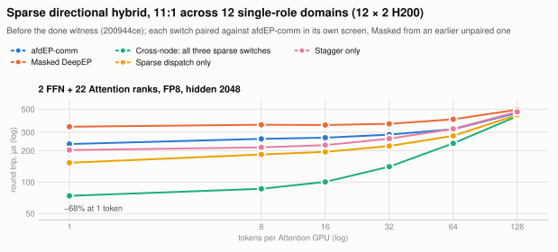
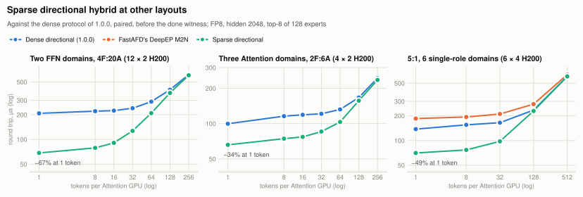

<div align="center">


<p><b>Expert-parallel communication for Attention–FFN Disaggregation (AFD).</b></p>

</div>

afdEP connects N Attention GPUs, which route tokens, with M FFN GPUs, which hold the
experts: it dispatches routed tokens to the experts and combines their outputs back at
the source. It vendors DeepEP V2's kernels and specializes them for the two roles.
Routing, quantization, expert compute and serving scheduling stay with the caller.

<picture>
  <source media="(prefers-color-scheme: dark)" srcset="docs/assets/communication-dark.svg">
  
</picture>

## What afdEP changes

The baseline is **Masked DeepEP**: the same vendored DeepEP V2 kernels with
`role_aware=False`. Every rank then joins a union world, Attention ranks hold dummy
expert slots, and every rank sends, receives and waits in both phases. The role path
(`role_aware=True`, the default) keeps the transport and removes only what the roles
make unnecessary; a change that would speed up Masked DeepEP as well is out of scope.
Every change keeps a control switch that restores the Masked behaviour.

One exchange in one NVLink domain, with every barrier, the kernels each role runs and
the inbox regions each rank registers and receives into:

<picture>
  <source media="(prefers-color-scheme: dark)" srcset="docs/assets/pipeline-dark.svg">
  
</picture>

In one NVLink domain:
- no entry barriers [§1](docs/design.md#1-entry-barriers); counts flow Attention → FFN only [§2](docs/design.md#2-directional-count-exchange);
  only receivers wait at exit, per sending CTA [§3](docs/design.md#3-directed-exit);
- receive buffers sized per role, 50% of the union registration at 2A2F and about 75%
  at 3:1 and 1:3 [§4](docs/design.md#4-role-sized-registered-buffers);
- each role launches only the warps it uses, and the FFN starts its copy epilogue at the
  counts [§14](docs/design.md#14-role-suites-launch-only-what-each-role-uses), [§15](docs/design.md#15-ffn-receive-copy-epilogue-trigger-at-the-counts-one-nvlink-domain);
- with one FFN rank, a single-FFN reduction and a zero-copy collect view
  [§10](docs/design.md#10-single-ffn-reduction), [§13](docs/design.md#13-single-ffn-collect-view).

Across NVLink domains joined by NCCL GPU-Initiated Networking (GIN):
- a directional protocol when every domain holds one role: no cross-domain barriers,
  and counts, payloads, finish tails and combine signals each flow one way
  [§7](docs/design.md#7-directional-hybrid-protocol), with route checks in the kernel
  [§8](docs/design.md#8-route-checks-inside-the-directional-hybrid-dispatch) and staging kept out of remotely written inboxes
  [§11](docs/design.md#11-staging-outside-remotely-written-inboxes-fix);
- domains that hold both roles (FFN GPUs sharing a node with Attention GPUs) run
  DeepEP's union hybrid and match Masked within 1.4%; the
  [cross-node proposal](#cross-node-proposal-opt-in-under-review) adds a directional path for them.

Opt-in and off by default: the [cross-node proposal](#cross-node-proposal-opt-in-under-review) ([§17](docs/design.md#17-sparse-directional-hybrid-opt-in-across-nvlink-domains), [§18](docs/design.md#18-mixed-role-directional-hybrid-opt-in-ffn-ranks-sharing-an-nvlink-domain)) and count-first dispatch [§16](docs/design.md#16-count-first-dispatch-with-a-streaming-ffn-expansion-opt-in-one-nvlink-domain). Every
change, its control and its evidence: [docs/design.md](docs/design.md).

## Results

Communication only: one dispatch plus combine round trip under CUDA graphs, in µs,
lower is better, maximum over Attention ranks. Each repeat runs one fresh process per
arm; latencies are medians over the repeats and every percentage is the geometric mean
of the per-repeat paired changes, as in [docs/design.md](docs/design.md). These are not
serving results. Data: [benchmarks.json](docs/assets/benchmarks.json); figures:
[plot_benchmarks.py](docs/assets/plot_benchmarks.py).

The Masked baseline is the deployed one: on 4 × H200 afdEP's Masked arm matches the
Masked DeepEP that afd-plugin serves within −0.4% to +1.2% at 2A2F and −0.2% to +0.3% at
3A:1F, from 1 to 2,048 tokens ([record](docs/validation-masked-equivalence.json)).

### One NVLink domain

<picture>
  <source media="(prefers-color-scheme: dark)" srcset="docs/assets/results-in-node-h100-dark.svg">
  
</picture>

On 4 × H100, afdEP cuts the one-token round trip by 27–35% against
Masked and the 2,048-token one by 1–5%, and is faster in every
repeat of every cell. This tree (`bd4db4da`) has the changes of sections 1–4; sections 10
and 13–15 came later and report their own gains on top.

<details><summary>4 × H100 numbers</summary>

4 × H100 in one NVLink domain, E128 / top-8 (E96 for 1A:3F), capacity 2,048, BF16 unless noted, 24 transport SMs; median of three fresh-process repeats, max over Attention ranks; native tree bd4db4da (sections 1–4, before sections 10 and 13–16). Record: [validation-result.json](docs/validation-result.json).

| 2A2F, hidden 2,048, random routing | T=1 | 8 | 32 | 128 | 512 | 2,048 |
|---|---:|---:|---:|---:|---:|---:|
| afdEP, µs | 20.7 | 24.8 | 26.3 | 35.3 | 70.6 | 192.7 |
| Masked DeepEP, µs | 31.7 | 34.4 | 36.0 | 44.3 | 78.7 | 201.0 |
| afdEP vs Masked DeepEP | −34.6% | −29.1% | −26.5% | −20.2% | −10.4% | −4.1% |

| 2A2F, hidden 4,096, random routing | T=1 | 8 | 32 | 128 | 512 | 2,048 |
|---|---:|---:|---:|---:|---:|---:|
| afdEP, µs | 28.4 | 39.2 | 46.3 | 61.5 | 127.3 | 383.2 |
| Masked DeepEP, µs | 39.1 | 47.9 | 55.7 | 68.7 | 136.2 | 392.6 |
| afdEP vs Masked DeepEP | −27.2% | −18.9% | −18.4% | −10.3% | −6.4% | −2.4% |

| 2A2F, hidden 2,048, skew routing | T=1 | 8 | 32 | 128 | 512 | 2,048 |
|---|---:|---:|---:|---:|---:|---:|
| afdEP, µs | 24.1 | 25.7 | 29.5 | 41.2 | 88.7 | 269.9 |
| Masked DeepEP, µs | 34.3 | 35.7 | 38.9 | 50.1 | 95.9 | 274.1 |
| afdEP vs Masked DeepEP | −29.5% | −27.6% | −24.1% | −17.5% | −7.6% | −1.5% |

| 3A:1F, hidden 2,048, random routing | T=1 | 8 | 32 | 128 | 512 | 2,048 |
|---|---:|---:|---:|---:|---:|---:|
| afdEP, µs | 24.8 | 27.4 | 33.0 | 45.9 | 109.4 | 367.8 |
| Masked DeepEP, µs | 36.4 | 38.6 | 44.8 | 55.8 | 119.5 | 372.1 |
| afdEP vs Masked DeepEP | −31.4% | −29.4% | −26.5% | −17.5% | −8.4% | −1.1% |

| 1A:3F, hidden 2,048, random routing | T=1 | 8 | 32 | 128 | 512 | 2,048 |
|---|---:|---:|---:|---:|---:|---:|
| afdEP, µs | 19.9 | 21.5 | 23.1 | 29.4 | 59.6 | 188.3 |
| Masked DeepEP, µs | 30.5 | 31.3 | 32.8 | 39.7 | 67.7 | 197.7 |
| afdEP vs Masked DeepEP | −34.2% | −31.3% | −29.3% | −24.9% | −12.2% | −4.7% |

| 2A2F FP8, hidden 2,048, random routing | T=1 | 8 | 32 | 128 | 512 | 2,048 |
|---|---:|---:|---:|---:|---:|---:|
| afdEP, µs | 21.3 | 25.9 | 26.8 | 34.5 | 62.5 | 159.1 |
| Masked DeepEP, µs | 32.3 | 35.6 | 36.7 | 43.5 | 71.8 | 167.8 |
| afdEP vs Masked DeepEP | −34.1% | −27.8% | −26.8% | −20.6% | −12.9% | −5.2% |

</details>

<picture>
  <source media="(prefers-color-scheme: dark)" srcset="docs/assets/results-in-node-h200-dark.svg">
  
</picture>

On 8 × H200 the one-token reduction grows with the Attention:FFN ratio:
22% at 4A:4F, 24% at 6A:2F and 39% at 7A:1F, where
afdEP is still 13% faster at 2,048 tokens.

<details><summary>8 × H200 numbers</summary>

8 × H200 in one NVLink domain (one pod), BF16, hidden 2048, top-8 of 128 experts, capacity 2,048, 24 SMs; 2 fresh processes per arm, max over Attention ranks; native tree 958652a3. Record: [validation-h200-screens.json](docs/validation-h200-screens.json).

| 6A:2F | T=1 | 8 | 32 | 128 | 512 | 2,048 |
|---|---:|---:|---:|---:|---:|---:|
| afdEP, µs | 24.3 | 29.3 | 35.5 | 53.2 | 152.0 | 502.0 |
| Masked DeepEP, µs | 32.2 | 38.1 | 43.7 | 61.2 | 157.9 | 507.9 |
| afdEP vs Masked DeepEP | −24.4% | −23.2% | −18.8% | −13.1% | −3.8% | −1.2% |

| 7A:1F | T=1 | 8 | 32 | 128 | 512 | 2,048 |
|---|---:|---:|---:|---:|---:|---:|
| afdEP, µs | 23.8 | 27.2 | 34.1 | 70.3 | 202.0 | 736.8 |
| Masked DeepEP, µs | 39.3 | 46.4 | 53.4 | 97.3 | 244.6 | 847.4 |
| afdEP vs Masked DeepEP | −39.5% | −41.3% | −36.0% | −27.8% | −17.4% | −13.0% |

| 4A:4F | T=1 | 8 | 32 | 128 | 512 | 2,048 |
|---|---:|---:|---:|---:|---:|---:|
| afdEP, µs | 24.3 | 26.6 | 27.8 | 39.6 | 96.0 | 296.3 |
| Masked DeepEP, µs | 31.1 | 35.1 | 36.1 | 47.4 | 102.8 | 302.9 |
| afdEP vs Masked DeepEP | −21.7% | −24.3% | −23.1% | −16.5% | −6.7% | −2.2% |

</details>

### Across NVLink domains

<picture>
  <source media="(prefers-color-scheme: dark)" srcset="docs/assets/results-cross-node-dark.svg">
  
</picture>

With one role per NVLink domain the directional protocol cuts the one-token round
trip by 30% at 11:1 over 12 domains and by 26% at 5:1 over 6 domains. When the
FFN GPUs share their node with Attention GPUs, the union hybrid runs and afdEP matches
Masked within 1.4%. On real 8-GPU nodes that is the common case at high ratios: an
11:1 deployment puts 2 FFN and 6 Attention GPUs on one node.

<details><summary>Cross-node numbers</summary>

H200 joined by InfiniBand (NCCL GIN), FP8, hidden 2048, top-8 of 128 experts, capacity 2,048, 24 SMs; 2 fresh processes per arm, max over Attention ranks; native tree 958652a3. Record: [validation-h200-screens.json](docs/validation-h200-screens.json).

| 11:1, 12 single-role domains (12 × 2 H200) | T=1 | 8 | 16 | 32 | 64 | 128 |
|---|---:|---:|---:|---:|---:|---:|
| afdEP, µs | 236.1 | 264.9 | 272.7 | 287.3 | 329.9 | 473.1 |
| Masked DeepEP, µs | 339.4 | 354.3 | 352.2 | 361.8 | 399.7 | 494.5 |
| afdEP vs Masked DeepEP | −30.5% | −25.2% | −22.6% | −20.6% | −17.5% | −4.3% |

| 5:1, 6 single-role domains (6 × 4 H200) | T=1 | 8 | 32 | 128 | 512 |
|---|---:|---:|---:|---:|---:|
| afdEP, µs | 137.8 | 155.3 | 165.0 | 235.1 | 604.8 |
| Masked DeepEP, µs | 185.4 | 193.6 | 210.7 | 277.9 | 636.0 |
| afdEP vs Masked DeepEP | −25.7% | −19.8% | −21.7% | −15.4% | −4.9% |

| 11:1, mixed-role FFN node (3 × 8 H200) | T=1 | 8 | 16 | 32 | 64 | 128 |
|---|---:|---:|---:|---:|---:|---:|
| afdEP, µs | 166.8 | 189.7 | 200.4 | 214.5 | 230.7 | 257.7 |
| Masked DeepEP, µs | 168.9 | 189.9 | 201.0 | 213.9 | 228.1 | 255.6 |
| afdEP vs Masked DeepEP | −1.3% | −0.1% | −0.3% | +0.3% | +1.1% | +0.8% |

| 11:1, mixed-role FFN domain (6 × 4 H200) | T=1 | 8 | 32 | 128 | 512 |
|---|---:|---:|---:|---:|---:|
| afdEP, µs | 212.1 | 235.4 | 265.0 | 333.5 | 763.8 |
| Masked DeepEP, µs | 211.3 | 235.7 | 264.6 | 332.4 | 760.4 |
| afdEP vs Masked DeepEP | +0.4% | −0.1% | +0.2% | +0.3% | +0.4% |

</details>

## Cross-node proposal (opt-in, under review)

Communication only, like the results above: one dispatch plus combine round trip under
CUDA graphs, maximum over Attention ranks; no serving results.

Across NVLink domains the remaining cost is synchronization that grows with the channel
count, not with the tokens, plus the union fallback on nodes that hold both roles. Two
opt-in additions address them. With every switch off, v1's kernels and launches are
unchanged, and in one NVLink domain nothing changes. Design, correctness argument and
evidence: [docs/design.md §17](docs/design.md#17-sparse-directional-hybrid-opt-in-across-nvlink-domains) and
[§18](docs/design.md#18-mixed-role-directional-hybrid-opt-in-ffn-ranks-sharing-an-nvlink-domain).

**Sparse directional hybrid** (`AFDEP_HYBRID_STAGGER=1`, `AFDEP_HYBRID_SPARSE_DISPATCH=1`,
`AFDEP_HYBRID_SPARSE_COMBINE=1`). Every exchange of the directional protocol signals all
C channels (192 at 24 SMs) whether they carry tokens or not, so at 11:1 an FFN GPU's NIC
takes 2,112 finish atomics in dispatch and sends as many combine signals. The switches
start each source on a different channel, publish token counts so FFN forwarders retire
unused channels, and signal only the channels that replied, plus a done witness sent once
every forward warp of the forwarder has finished. Set them alike on every rank before
constructing the `Buffer`; construction rejects a mismatch.

<picture>
  <source media="(prefers-color-scheme: dark)" srcset="docs/assets/results-xn-sparse-dark.svg">
  
</picture>

At 11:1 over 12 single-role domains, all three switches cut the round trip by
68% against v1 at one token, 51% at 32 and 7% at 128 tokens, and are
neutral at 512. These and the scaling screens below ran on trees before the done witness
(`200944ce`, and `2d22e5e9` at 5:1). The switches compound: sparse combine alone gains
about 2%, and our untraced reading is that it removes the outbound signals that become
the bottleneck once the stagger spreads the replies.

<picture>
  <source media="(prefers-color-scheme: dark)" srcset="docs/assets/results-xn-scaling-dark.svg">
  
</picture>

The gain scales with the number of Attention domains: 34% at one token with
three Attention domains, 49% at 5:1 over six 4-GPU domains and 67% with two FFN domains.
The done witness is required for correctness: with the earlier witness on channel 0 only,
a source could overwrite an inbox the FFN combine still reads (argued from the layout and
the code; fault injection did not reproduce it). It costs +6.6% at 8 tokens
at 5:1 and is within ±1.2% elsewhere; the 12-domain layouts have not been re-measured
with it.

**Mixed-role directional hybrid** (`AFDEP_MIXED_HYBRID=1` on every rank, prototype). When
FFN ranks fill only part of a node, every GPU gets its role individually: each GPU on the
FFN node still receives its rail's tokens on its own NIC (node-wide ingress), only the FFN
GPUs hold experts, the node's Attention GPUs also send their own tokens locally, and
Attention-only nodes just send and collect.

<picture>
  <source media="(prefers-color-scheme: dark)" srcset="docs/assets/results-xn-mixed-dark.svg">
  
</picture>

It cuts the round trip against v1 by 23% at one token and 8% at 512 tokens at
11:1, and by 21% and 6% at 23:1. It was measured and validated on 4-GPU NVLink
domains only (6 × 4 H200, F = 1 to 3, one FFN-holding domain); 8-GPU nodes, fault
injection for its reply and staging orderings and a two-buffer interleave are not yet
run. The sparse switches do not apply to this path yet.

<details><summary>Cross-node proposal numbers</summary>

H200 joined by InfiniBand (NCCL GIN), FP8, hidden 2048, top-8 of 128 experts, capacity 2,048, 24 SMs; 2 fresh processes per arm, max over Attention ranks; v1 on 958652a3, the proposal on the tree each dataset's digests name (64 experts at 23:1).

| All three switches (200944ce, before the done witness), 11:1 over 12 domains | T=1 | 8 | 16 | 32 | 64 | 128 | 256 | 512 |
|---|---:|---:|---:|---:|---:|---:|---:|---:|
| afdEP v1, µs | 231.5 | 259.5 | 266.3 | 285.0 | 320.9 | 461.0 | 712.4 | 1,220.1 |
| Cross-node: all three sparse switches, µs | 73.8 | 86.2 | 100.4 | 140.5 | 235.1 | 428.1 | 691.2 | 1,221.1 |
| Cross-node: all three sparse switches vs afdEP v1 | −68.1% | −66.8% | −62.3% | −50.7% | −26.7% | −7.1% | −3.0% | +0.1% |

| Stagger and sparse dispatch, 11:1 | T=1 | 8 | 16 | 32 | 64 | 128 |
|---|---:|---:|---:|---:|---:|---:|
| afdEP v1, µs | 231.3 | 259.9 | 266.8 | 285.2 | 321.4 | 460.7 |
| Stagger only, µs | 202.7 | 215.0 | 225.9 | 260.8 | 323.5 | 470.8 |
| Sparse dispatch only, µs | 153.1 | 183.8 | 194.7 | 221.5 | 277.6 | 441.0 |
| Stagger + sparse dispatch, µs | 131.0 | 144.3 | 154.2 | 197.9 | 280.8 | 452.3 |
| Stagger only vs afdEP v1 | −12.4% | −17.3% | −15.3% | −8.5% | +0.7% | +2.2% |
| Sparse dispatch only vs afdEP v1 | −33.8% | −29.3% | −27.0% | −22.3% | −13.6% | −4.3% |
| Stagger + sparse dispatch vs afdEP v1 | −43.4% | −44.5% | −42.2% | −30.6% | −12.6% | −1.8% |

| Sparse combine, 11:1 | T=1 | 8 | 16 | 32 | 64 | 128 |
|---|---:|---:|---:|---:|---:|---:|
| afdEP v1, µs | 231.7 | 260.0 | 266.2 | 285.1 | 321.1 | 460.9 |
| Sparse combine only, µs | 226.0 | 255.7 | 264.8 | 284.5 | 320.4 | 460.3 |
| Sparse dispatch + combine, µs | 151.5 | 180.8 | 194.0 | 221.1 | 276.5 | 440.9 |
| Cross-node: all three sparse switches, µs | 74.3 | 86.3 | 100.4 | 140.8 | 235.5 | 428.0 |
| Sparse combine only vs afdEP v1 | −2.4% | −1.6% | −0.5% | −0.2% | −0.2% | −0.1% |
| Sparse dispatch + combine vs afdEP v1 | −34.6% | −30.5% | −27.1% | −22.4% | −13.9% | −4.3% |
| Cross-node: all three sparse switches vs afdEP v1 | −67.9% | −66.8% | −62.3% | −50.6% | −26.6% | −7.1% |

| Stagger bound, 11:1 | T=1 | 8 | 16 | 32 | 48 | 64 | 128 |
|---|---:|---:|---:|---:|---:|---:|---:|
| afdEP v1, µs | 231.6 | 260.2 | 266.3 | 285.0 | 300.1 | 321.5 | 460.7 |
| Sparse dispatch + combine, µs | 148.3 | 179.8 | 193.4 | 221.2 | 247.7 | 277.3 | 441.0 |
| + stagger up to 48 tokens, µs | 74.2 | 86.2 | 100.2 | 140.6 | 188.8 | 277.5 | 440.8 |
| + stagger at every size, µs | 74.0 | 86.3 | 100.4 | 140.6 | 188.5 | 236.1 | 428.6 |
| Sparse dispatch + combine vs afdEP v1 | −36.0% | −30.9% | −27.4% | −22.4% | −17.5% | −13.7% | −4.3% |
| + stagger up to 48 tokens vs afdEP v1 | −68.0% | −66.9% | −62.4% | −50.7% | −37.1% | −13.7% | −4.3% |
| + stagger at every size vs afdEP v1 | −68.0% | −66.8% | −62.3% | −50.7% | −37.2% | −26.6% | −7.0% |

| Two FFN domains, 4F:20A (12 × 2 H200) | T=1 | 8 | 16 | 32 | 64 | 128 | 256 |
|---|---:|---:|---:|---:|---:|---:|---:|
| afdEP v1, µs | 207.9 | 221.0 | 224.4 | 240.0 | 288.7 | 403.5 | 615.1 |
| Cross-node: all three sparse switches, µs | 68.5 | 79.0 | 90.9 | 127.2 | 209.0 | 368.8 | 604.6 |
| Cross-node: all three sparse switches vs afdEP v1 | −67.1% | −64.3% | −59.5% | −47.0% | −27.6% | −8.6% | −1.7% |

| Three Attention domains, 2F:6A (4 × 2 H200) | T=1 | 8 | 16 | 32 | 64 | 128 | 256 |
|---|---:|---:|---:|---:|---:|---:|---:|
| afdEP v1, µs | 99.7 | 115.7 | 118.8 | 121.2 | 132.1 | 166.8 | 244.4 |
| Cross-node: all three sparse switches, µs | 65.9 | 74.4 | 77.0 | 85.5 | 103.2 | 156.8 | 235.6 |
| Cross-node: all three sparse switches vs afdEP v1 | −33.9% | −35.7% | −35.2% | −29.5% | −21.9% | −6.0% | −3.6% |

| 5:1, 6 single-role domains (6 × 4 H200) | T=1 | 8 | 32 | 128 | 512 |
|---|---:|---:|---:|---:|---:|
| afdEP v1, µs | 137.8 | 155.3 | 165.0 | 235.1 | 604.8 |
| Cross-node: all three sparse switches, µs | 70.5 | 76.8 | 97.7 | 229.4 | 604.8 |
| Masked DeepEP, µs | 185.4 | 193.6 | 210.7 | 277.9 | 636.0 |
| Cross-node: all three sparse switches vs afdEP v1 | −48.8% | −50.5% | −40.8% | −2.4% | −0.0% |
| Masked DeepEP vs afdEP v1 | +34.5% | +24.7% | +27.7% | +18.2% | +5.2% |

| Done witness cost, 5:1 (6 × 4 H200) | T=1 | 8 | 32 | 128 | 512 |
|---|---:|---:|---:|---:|---:|
| afdEP v1, µs | 138.0 | 155.5 | 164.6 | 235.2 | 604.3 |
| Sparse, earlier witness on channel 0 only (unsafe), µs | 70.8 | 77.3 | 97.6 | 229.5 | 605.0 |
| Sparse, done witness after every forward warp, µs | 70.7 | 82.3 | 97.7 | 226.8 | 603.8 |
| Sparse, earlier witness on channel 0 only (unsafe) vs afdEP v1 | −48.7% | −50.3% | −40.7% | −2.4% | +0.1% |
| Sparse, done witness after every forward warp vs afdEP v1 | −48.8% | −47.1% | −40.7% | −3.6% | −0.1% |

| 11:1, 2F:22A, 128 experts (6 × 4 H200) | T=1 | 8 | 32 | 128 | 512 |
|---|---:|---:|---:|---:|---:|
| afdEP v1, µs | 212.1 | 235.4 | 265.0 | 333.5 | 763.8 |
| Cross-node: mixed-role directional, µs | 163.0 | 189.0 | 207.5 | 284.1 | 701.6 |
| Masked DeepEP, µs | 211.3 | 235.7 | 264.6 | 332.4 | 760.4 |
| Cross-node: mixed-role directional vs afdEP v1 | −23.2% | −19.7% | −21.7% | −14.8% | −8.1% |
| Masked DeepEP vs afdEP v1 | −0.4% | +0.1% | −0.2% | −0.3% | −0.4% |

| 23:1, 1F:23A, 64 experts (6 × 4 H200) | T=1 | 8 | 32 | 128 | 512 |
|---|---:|---:|---:|---:|---:|
| afdEP v1, µs | 280.3 | 319.4 | 353.4 | 437.5 | 1,082.7 |
| Cross-node: mixed-role directional, µs | 222.2 | 267.6 | 294.0 | 383.4 | 1,015.5 |
| Masked DeepEP, µs | 279.2 | 319.6 | 352.9 | 436.1 | 1,080.3 |
| Cross-node: mixed-role directional vs afdEP v1 | −20.7% | −16.2% | −16.8% | −12.4% | −6.2% |
| Masked DeepEP vs afdEP v1 | −0.4% | +0.1% | −0.2% | −0.3% | −0.2% |

In one NVLink domain, tree `200944ce` matches v1 with the switches off and on; the later
done witness and the mixed-role path run only with two or more NVLink domains.
one NVLink domain of 8 × H200 (one pod), BF16, hidden 2048, top-8 of 128 experts, capacity 2,048, 24 SMs; 2 fresh processes per arm, max over Attention ranks.

| 6A:2F | T=1 | 8 | 32 | 128 | 512 | 2,048 |
|---|---:|---:|---:|---:|---:|---:|
| afdEP v1, µs | 24.3 | 29.3 | 35.5 | 53.2 | 152.0 | 502.0 |
| Tree 200944ce, switches off, µs | 24.2 | 29.3 | 35.3 | 53.2 | 151.9 | 501.6 |
| Tree 200944ce, switches on, µs | 24.6 | 28.9 | 35.5 | 53.2 | 152.2 | 501.8 |
| Tree 200944ce, switches off vs afdEP v1 | −0.6% | +0.2% | −0.6% | +0.0% | −0.0% | −0.1% |
| Tree 200944ce, switches on vs afdEP v1 | +1.0% | −1.2% | +0.2% | +0.1% | +0.2% | −0.0% |

| 7A:1F | T=1 | 8 | 32 | 128 | 512 | 2,048 |
|---|---:|---:|---:|---:|---:|---:|
| afdEP v1, µs | 23.8 | 27.2 | 34.1 | 70.3 | 202.0 | 736.8 |
| Tree 200944ce, switches off, µs | 23.9 | 27.0 | 34.1 | 69.9 | 201.6 | 736.5 |
| Tree 200944ce, switches on, µs | 23.9 | 27.1 | 33.8 | 69.5 | 201.9 | 736.7 |
| Tree 200944ce, switches off vs afdEP v1 | +0.3% | −0.8% | −0.0% | −0.6% | −0.2% | −0.0% |
| Tree 200944ce, switches on vs afdEP v1 | +0.5% | −0.4% | −1.2% | −1.0% | −0.0% | −0.0% |

| 4A:4F | T=1 | 8 | 32 | 128 | 512 | 2,048 |
|---|---:|---:|---:|---:|---:|---:|
| afdEP v1, µs | 24.3 | 26.6 | 27.8 | 39.6 | 96.0 | 296.3 |
| Tree 200944ce, switches off, µs | 24.3 | 26.5 | 27.8 | 39.9 | 96.0 | 296.5 |
| Tree 200944ce, switches on, µs | 24.2 | 26.5 | 27.8 | 39.9 | 96.1 | 296.9 |
| Tree 200944ce, switches off vs afdEP v1 | +0.0% | −0.2% | +0.3% | +0.8% | +0.0% | +0.1% |
| Tree 200944ce, switches on vs afdEP v1 | −0.6% | −0.1% | +0.3% | +0.9% | +0.2% | +0.2% |

</details>

## Use

Linux, PyTorch ≥2.6, a CUDA toolkit with `nvcc`, and NCCL ≥2.30.7 with device headers
are required. The release was validated with PyTorch 2.13.0+cu130, CUDA 13.0 and NCCL 2.30.7.

```bash
pip install .
# Set these before starting Python; select the same NCCL headers and runtime.
export AFDEP_NCCL_ROOT=/path/to/nccl
export LD_LIBRARY_PATH="$AFDEP_NCCL_ROOT/lib:$LD_LIBRARY_PATH"
# For a single NVLink domain, without network communication:
export EP_DISABLE_GIN=1
python -m afdep doctor --build
```

```python
from afdep import Buffer, Config

# Set the CUDA device and initialize a CPU Gloo group first.
# Group ranks [0, 2) own experts; [2, 4) originate tokens.
comm = Buffer(
    group=group,
    config=Config(
        capacity_tokens_per_rank=2048,
        hidden_size=4096,
        num_experts=128,
        top_k=8,
        ffn_ranks=2,
        attention_ranks=2,
    ),
)
if comm.role == "attention":
    comm.source_dispatch(x, expert_ids, weights, bucket=2048)
    output = comm.source_collect()
else:
    received = comm.worker_receive(bucket=2048)
    weighted_rows = run_experts(received)  # Caller applies each routing weight once.
    comm.worker_reply(weighted_rows, received.receipt)
comm.close()  # Collective, after all exchanges and graph replays finish.
```

Routing, quantization and expert computation belong to the caller. BF16 and
prequantized FP8 dispatch return BF16 combined outputs. See the
[tensor, graph and lifecycle contract](docs/api.md).

## Support

| Architecture | Evidence | Scope |
|---|---|---|
| Hopper (SM90) | GPU suite of the release tree on 4 × H200; earlier trees on H100 and over two to five H200 NVLink domains | BF16/FP8; eager and CUDA graphs; one NVLink domain, or several joined by GIN |
| Blackwell (SM100) | Not validated | Port tracked in [#2](https://github.com/afdEP/afdEP/issues/2) |
| Other architectures | Not validated | No support claim yet |

The GPU suite (BF16 and FP8, small and large capacities, eager and CUDA graphs, invalid
routes) passes on the release tree with 2A2F, 3A:1F and 1A:3F in one four-GPU NVLink
domain ([record](docs/validation-count-first.json), `default_off_shipped`). Across
NVLink domains the directional protocol passed it on earlier trees over two to four
domains of two H200 GPUs and four and five single-GPU domains joined by InfiniBand GIN
([three](docs/validation-three-domain.json), [four](docs/validation-four-domain.json)
and [five domains](docs/validation-five-domain.json),
[eight ranks](docs/validation-eight-rank.json),
[staging fix](docs/validation-staging-fix.json)). The 8-GPU NVLink domain and the
24-rank layouts under Results are measured, not suite-validated. Other layouts
and larger multi-domain worlds require validation. `allow_hybrid_mode` keeps DeepEP's
meaning; it does not enable an unvalidated topology.

The cross-node proposal is opt-in and validated more narrowly. The sparse switches
passed the GPU suite on 24 ranks (12 × 2 and 6 × 4 H200) with FP8 only; with the done
witness, only on 6 × 4 H200 at capacity 2,048
([record](docs/validation-v1-sparse-hybrid.json)). The mixed-role path passed it on
6 × 4 H200 with F = 1 to 3 ([record](docs/validation-v1-mixed-hybrid.json)).

[Design and evidence](docs/design.md) · [v0 validation](docs/validation.md) ·
[Contributing](CONTRIBUTING.md) · [Licenses and provenance](THIRD_PARTY_NOTICES.md)
