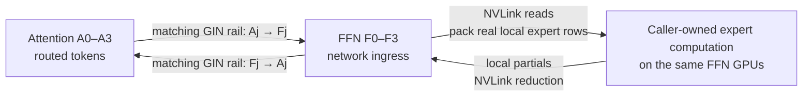

# Architecture

AFDEP owns the communication between separate token-source and expert-worker
domains. It accepts activations and routing metadata, provides expert-major
receive rows, and returns combined BF16 outputs. It does not choose experts,
load model weights, execute expert GEMMs, or implement a serving scheduler.

## Initial topology

The first backend fixes the group ordering to `[F0, F1, F2, F3, A0, A1, A2, A3]`.
Each role occupies a complete four-GPU NVLink domain. Every FFN rank owns
`num_experts / 4` consecutive expert IDs. The topology check must reject other
group sizes, placements, and role counts.

An FFN rank is both a network ingress and an expert owner. A request arrives at
the matching ingress GPU, which need not own the selected experts. All FFN GPUs
can read the ingress request over NVLink. The activation crosses the network
once per source token, rather than once per selected expert GPU. The FFN domain
then returns one reduced reply for that source.

This is directional request/reply traffic, not a masked invocation of a general
expert-parallel all-to-all. It still has local fan-out, reduction, coordination,
and credit traffic. It does not eliminate the synchronization needed to protect
shared buffers.

## Layers

| Layer | Responsibility |
|---|---|
| Python `Config` / `Buffer` | Configuration, process-group bootstrap, tensor contracts, CUDA-stream integration, lifecycle |
| AFDEP native data plane | Packet and window layout, expert-row packing, receipts, epochs, credits, and reply reduction |
| NCCL GIN | GPU-initiated registered-window transfers and remote completion signals |
| NVLink peer mapping | FFN-local request reads and partial-result reads |
| Caller | Routing, FP8 quantization, expert compute, weighting, batching, and scheduling |

There is no runtime dependency on the `deep_ep` or `vllm` Python package. AFDEP
retains a minimal attributed subset of upstream transport infrastructure. AFDEP
owns its NCCL bootstrap/window wrapper and builds a standalone extension through
PyTorch's C++ extension tooling. It does not carry DeepEP's JIT, expert kernels,
DeepGEMM, CUTLASS, or `fmt`. The retained transport helpers do not invoke DeepEP's
dispatch/combine data plane. This distinction should remain visible when
modifying vendored code or expanding the backend.

## Memory ownership

Each source owns a registered request region and a registered reply region.
Each worker owns a registered request-ingress region, per-source local partials,
and an outgoing reply region. Control fields share the registered windows.
Expert-major receive tensors and expert outputs are ordinary PyTorch CUDA
tensors, separate from the registered transport windows.

Capacity is configured once; actual source token counts travel in request
headers. Receive allocations conservatively bound the possible expert-row
expansion for the selected bucket, including alignment padding. Passing an
allocation length as an actual token or row count is incorrect.

One buffer has one in-flight lane. Its persistent device epoch, signal counters,
and reader credits distinguish successive exchanges, including graph replays.
The caller must finish the complete source dispatch/collect or worker
receive/reply sequence before beginning another exchange on that buffer. More
concurrency requires a separate, explicitly validated ownership design.

## Lifecycle and failure scope

All eight participants construct their buffers in the same order on a CPU Gloo
group. Bootstrap exchanges communicator information, verifies placement, creates
registered windows, and initializes control state. Teardown synchronizes each
device and enters a group barrier before releasing memory that a remote GPU may
still read.

Device polling has timeouts to expose missing progress. A timeout or device
assertion is a fatal exchange failure, not a recoverable empty reply. Applications
must terminate the participating worker group and reconstruct its communication
state rather than continue using a partially advanced buffer.

## Expansion points

New topologies need explicit ingress selection, expert ownership, source/reply
addressing, and reader-credit rules. Multiple lanes need independent epochs,
registered slots, and complete ownership transfer. A backend for another GPU
architecture needs validation of its memory-ordering and GIN assumptions in
addition to compilation. These are planned extensions, not current capabilities.
